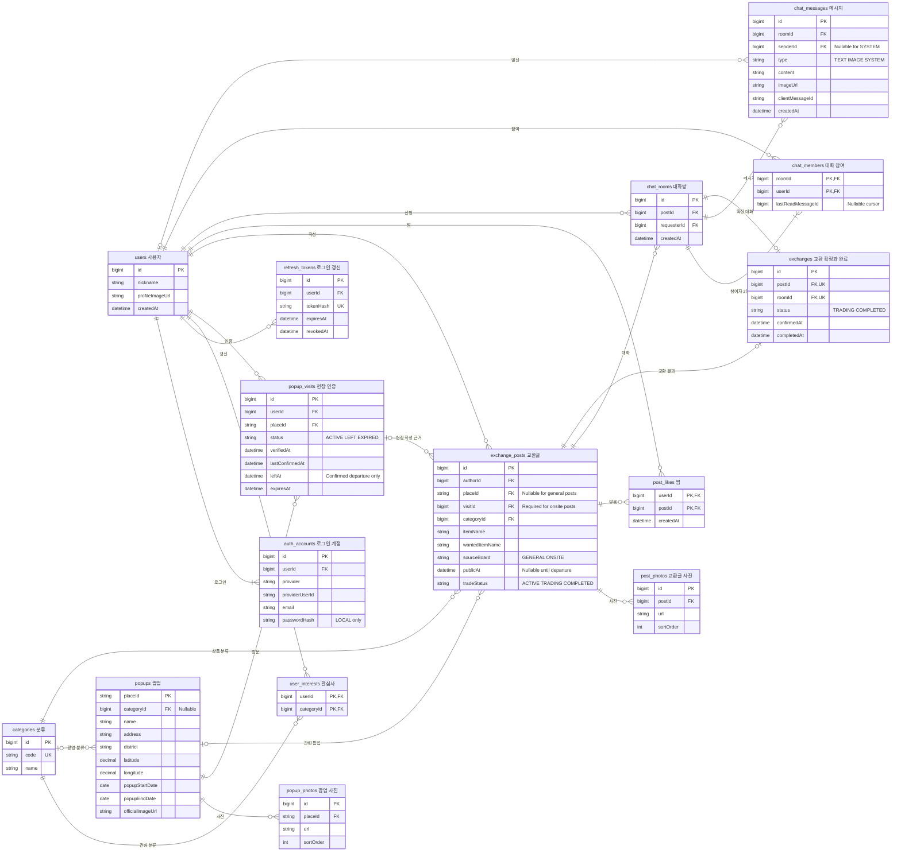

# PICKIT MVP ERD v1

2026-11-12 설계 초안. 현재 DB에 적용된 스키마가 아니다. 핵심 테이블 15개로 구성하며 프리미엄, 결제, 댓글, 별점, 알림은 이 핵심 ERD에 포함하지 않았다.

데이터 항목별 한국어 설명은 [PICKIT ERD · 데이터 항목 설명](https://app.notion.com/p/41612b5b1ed7814d9764e52f4cdb049e)에서 확인한다.

## ERD

## 표기와 키

- 그림의 camelCase 필드는 API/Java에서 이해하기 위한 표기다. 실제 SQL 컬럼은 snake_case로 매핑한다.
- placeId는 팝업 원본의 문자열 식별자다. 241개 데이터 안에서 중복이 없음을 확인했다.
- PK는 기본키, FK는 외래키, UK는 유일 제약이다. 복합 유일 제약은 아래에 별도로 명시한다.
- 선택 관계는 nullable FK를 뜻한다. 현장 글의 필수 조합은 서비스와 DB 제약으로 검증한다.
- 시각은 절대 시각으로 저장하고 응답에 시간대 정보를 포함한다. 팝업 진행 상태는 서울 날짜로 계산한다.

## 테이블 책임

| 테이블 | 담당 | 목적 |
|---|---|---|
| users | B | 공통 사용자 식별자와 프로필 |
| auth_accounts | B | LOCAL/GOOGLE 로그인 식별 정보 |
| refresh_tokens | B | 로그인 갱신과 로그아웃 |
| categories | A | 상품·관심사 공통 분류 |
| user_interests | A | 사용자의 관심 분류 |
| popups | A | 기존 JSON에서 가져온 팝업 카탈로그 |
| popup_photos | A | 팝업 갤러리 URL과 순서 |
| popup_visits | A | 현장 인증, 마지막 확인, 이탈과 만료 |
| exchange_posts | A | 일반/현장 교환글과 교환 완료 상태 |
| post_photos | A | 사용자가 올린 교환 상품 사진 |
| post_likes | A | 사용자별 찜 |
| chat_rooms | B | 글에 연결된 1:1 대화방 |
| chat_members | B | 참여자와 읽은 메시지 위치 |
| chat_messages | B | 문자·이미지·시스템 메시지 |
| exchanges | B | 교환 상대 확정과 완료 기록. 예약 시간 없음 |

## 그림에서 생략한 일반 컬럼

ERD의 가독성을 위해 모든 테이블의 생성/수정 시각을 반복하지 않았다.

- popups에는 place_url, homepage_url을 추가로 보관한다.
- exchange_posts에는 description, meeting_place_text, meeting_time_text, created_at, updated_at, deleted_at이 필요하다.
- meeting_time_text는 글에 적는 자유 설명용이다. 교환 확정 단계에서 시각을 선택·예약하는 scheduled_at 필드는 없다.
- auth_accounts.password_hash는 LOCAL만 사용하고 GOOGLE은 null이다. Google 식별은 이메일 문자열 대신 provider_user_id의 안정적인 계정 ID로 한다.
- refresh_tokens에는 원문이 아닌 token_hash를 저장한다.
- chat_messages.sender_id는 서버가 만든 SYSTEM 메시지만 null을 허용한다. 사용자 메시지는 실제 방 참여자여야 한다.

## 반드시 지킬 제약

| 제약 | 이유 |
|---|---|
| auth_accounts UNIQUE(provider, provider_user_id) | 같은 로그인 계정 중복 생성 방지 |
| user_interests PK(user_id, category_id) | 관심사 중복 방지 |
| post_likes PK(user_id, post_id) | 한 사람이 같은 글을 중복 찜하지 않음 |
| chat_rooms UNIQUE(post_id, requester_id) | 같은 글의 같은 신청자 대화방 재사용 |
| chat_members PK(room_id, user_id) | 참여자 중복 방지 |
| exchanges UNIQUE(post_id), UNIQUE(room_id) | 글 하나당 한 상대방 확정이라는 초기안. 동시 확정 방지 |
| post_photos UNIQUE(post_id, sort_order) | 사진 순서 일관성 |
| popup_photos UNIQUE(place_id, sort_order) | 갤러리 순서 일관성 |
| post source_board=ONSITE이면 place_id·visit_id 필수 | 현장 글을 인증 방문과 연결 |
| post.visit의 사용자와 팝업이 post 작성자·팝업과 일치 | 다른 사람의 방문 인증 재사용 방지 |

- chat_members는 방마다 글쓴이와 신청자 정확히 2명으로 생성한다.
- message.sender_id와 chat_rooms.requester_id는 요청으로 위조하지 못하게 인증된 사용자로 결정한다.
- exchange의 room이 해당 post의 방인지 확인한다.
- last_read_message_id는 읽음 커서로 저장한다. 해당 방의 메시지인지 애플리케이션에서 검증하고 이전 읽음 위치로 되돌리지 않는다.
- 메시지 재시도는 room_id, sender_id, client_message_id 조합으로 중복을 제거한다.
- 서로 다른 제공자의 같은 이메일을 검증 없이 자동 연결하지 않는다. 계정 연결 기능은 초기 범위 밖이다.

## 조회 인덱스 초안

- popups(popup_start_date, popup_end_date), popups(district, category_id)
- popup_visits(user_id, status, expires_at), popup_visits(place_id, status)
- exchange_posts(public_at, created_at, id), exchange_posts(place_id, source_board, created_at, id)
- exchange_posts(author_id, created_at), exchange_posts(category_id, created_at)
- chat_members(user_id, room_id), chat_messages(room_id, id)
- exchanges(status, confirmed_at)

현재 241개 팝업 규모에서는 반경 조회를 위한 별도 검색 서버나 공간 인덱스를 먼저 도입하지 않아도 된다. 먼저 정확한 거리 계산과 권한 정책을 구현한다.

## 교환 상태와 내 약속 탭

교환글은 일반(ACTIVE) → 교환 중(TRADING) → 교환 완료(COMPLETED) 순서다. 교환 확정 버튼을 누르면 글과 교환 기록이 TRADING이 되고 해당 상대방의 채팅방만 내 약속 탭에 나타난다. 완료 버튼을 누르면 두 상태가 COMPLETED가 되어 내 약속에서 빠지며, 글과 대화 기록은 남는다. 전체/현장이라는 공개 범위는 이 교환 상태와 별개다.

내 약속은 게시글 상태만 보고 같은 글의 모든 대화방을 넣으면 안 된다. exchanges.room_id로 확정된 상대방의 방을 찾고, exchanges.status=TRADING이면서 본인이 그 방의 참여자인 경우만 포함한다.

## 상태를 분리하는 이유

- source_board와 public_at은 누가 글을 볼 수 있는지 결정한다.
- trade_status는 ACTIVE(일반), TRADING(교환 중), COMPLETED(교환 완료)를 나타낸다. exchanges.status도 교환 중에는 TRADING, 완료 후에는 COMPLETED로 함께 변경한다.
- exchanges는 어느 채팅 상대와 확정했는지 기록한다.
- 방문의 left_at은 실제 이탈 확인 시각이며 expires_at과 다르다.
- Live/New/방금 전은 위 시각에서 계산하는 표시값이므로 게시글의 교환 상태 enum에 넣지 않는다.
- 교환 완료는 글 삭제와 다르다. 명시적 글 삭제는 deleted_at을 사용하고 기존 대화·교환 기록의 FK를 보존한다.

